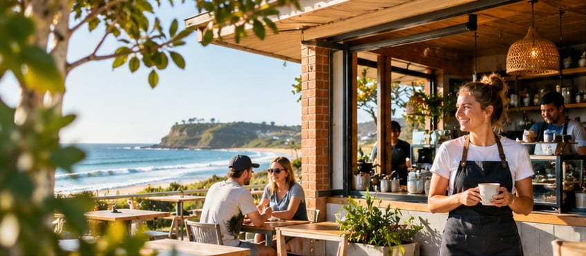
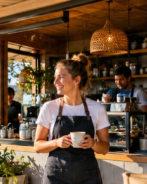
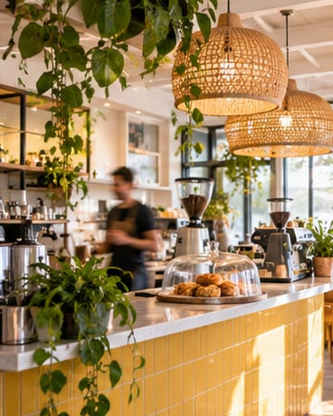
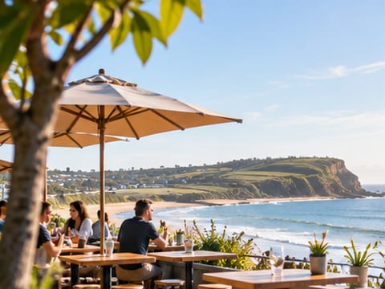

# Coastal café imagery — owner review

**Status: draft, for internal review only.** These are AI-generated illustrations in a photographic style,
not photographs of a real café or staff, and not screenshots of Butterbox. The owner has approved the Coastal
Wave direction, not these individual images. Rights and final visual approval are pending.

Open the [responsive review preview](cafe-concepts/preview.html) to see the selections together at desktop and
mobile widths. It is a standalone review page, **not** the live application or a deployed homepage.

## Recommended selection

| Placement | Visual | Why / largest prepared crop |
| --- | --- | --- |
| Homepage hero, desktop |  | The café, staff and ocean communicate the desired welcoming coastal setting. **848 × 371 px**, 16:7. Place the headline beside it on a solid background rather than relying on text over the busy image. |
| Homepage hero, phone |  | A portrait crop keeps the worker in view but loses the ocean context. **296 × 370 px**, 4:5. It is a small review crop, not a sharp full-width mobile master. |
| Team / rostering |  | Friendly, collaborative team; the laptop implies coordination without showing a fabricated product interface. **564 × 376 px**, 3:2. |
| Team alternative |  | A square collaboration option for a compact feature card. **384 × 384 px**; the tablet and people are partially cropped at the edges. |
| Café operations |  | The timber, warm light and coffee equipment support the café-operations story. **368 × 460 px**, 4:5. |
| Supporting atmosphere |  | A relaxed coastal setting for a secondary section; it does not claim to depict Long Reef or any actual venue. **480 × 360 px**, 4:3. |
| Supporting service |  | A friendly service moment to balance the workplace imagery. **360 × 450 px**, 4:5; inspect the hands and details during final visual review. |

Other supplied scenes remain available in the
[source contact sheet](../originals/website_imagery/PREVIEW_CONTACT_SHEET.jpg). None has been discarded.

## Resolution and delivery

The supplied source consists of two generated contact sheets, measured at **1536 × 1024** and **1672 × 941**
pixels. The supplied separate hero JPEG is **861 × 377** pixels; the clean hero region used for the drafts
is **859 × 377** pixels. This is not a native 3200 × 1800 standalone hero, and the original generation
resolution before the supplied sheets is not independently known. No draft image was enlarged during encoding.
Even at the largest provided size, a browser may visibly enlarge these drafts on a large or high-density screen.

The [manifest](cafe-concepts/manifest.json) records the source sheet, exact region, crop position, dimensions,
alternative text, bytes and SHA-256 for each output. There are 49 images: three AVIF and three WebP widths plus
a largest-size JPEG fallback for each of seven sets. All 49 together are **1,069,112 bytes**; the largest
individual output is the **68,784-byte** hero JPEG. A page loads selected variants, not the entire library.

The supplied individual JPEGs for some scenes include strips from neighbouring contact-sheet cells. The review
crops are made directly from the preserved PNG sheets with those gutters excluded. The source files and supplied
individual cuts remain unchanged. The draft preview uses informative alt text describing each illustration;
in an actual placement, use `alt=""` only when the image is genuinely decorative.

## Provenance and publication gates

- The [supplier's README](../originals/website_imagery/README.md) reports OpenAI ChatGPT image generation on
  2026-11-03. It supplies a prompt *summary*, not the exact generation prompt, model/version or generation
  record. Those details and the account under which generation occurred have not been independently verified.
- The [OpenAI Terms of Use](https://openai.com/policies/terms-of-use/) reviewed on 2026-11-03, effective
  2026-01-01, state that, as between the user and OpenAI and subject to applicable law, the user owns output;
  they also state that output may not be unique and that users are responsible for rights and permissions.
  The [Sharing and Publication Policy](https://openai.com/policies/sharing-publication-policy/) calls for
  review and clear disclosure of AI-generated content. These public documents do **not** establish which terms
  applied to this generation account or clear third-party, trademark, location or other rights.
- Before marketing publication, the owner must verify the applicable account terms and source/input rights,
  complete any appropriate third-party review, and approve the specific files and intended placements. Do not
  imply these synthetic people or fictional locations are real.
- Obtain or create a properly rights-reviewed, individually generated or licensed **native 3200 × 1800 or
  larger hero**, and appropriately sized supporting masters, before declaring the photographic-style library
  production-ready. Never describe an upscaled file as a native high-resolution master.

**Owner decision:** Select or reject the proposed images above; final approval is not yet recorded. BB-BRAND-004
remains **Blocked** on these publication, resolution and owner-review gates.
