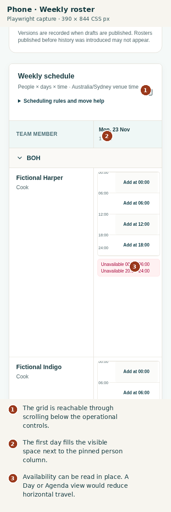

# Screenshot evidence

Screenshots show the local showcase with fictional records. The annotated variants add numbered markers and notes to genuine Playwright captures. Grid close-ups were captured after scrolling. The first-viewport images show the controls encountered when entering. Wireframes are separate design proposals. [Design wireframes](wireframes.html)

## Annotated captures

| Viewport | Surface | Evidence |
| --- | --- | --- |
| Desktop 1440×1000 | Owner weekly roster, scrolled to grid | [Annotated grid](evidence/owner-desktop-roster-grid-annotated.png) · [Original](evidence/owner-desktop-roster-grid.png) · [First viewport](evidence/owner-desktop-roster.png) |
| Tablet 820×1180 | Owner weekly roster, scrolled to grid | [Annotated grid](evidence/owner-tablet-roster-grid-annotated.png) · [Original](evidence/owner-tablet-roster-grid.png) · [First viewport](evidence/owner-tablet-roster.png) |
| Phone 390×844 | Owner weekly roster, scrolled to grid | [Annotated grid](evidence/owner-mobile-roster-grid-annotated.png) · [Original](evidence/owner-mobile-roster-grid.png) · [First viewport](evidence/owner-mobile-roster.png) |
| Desktop 1440×1000 | Owner venue settings | [Annotated settings](evidence/owner-desktop-settings-organisation-annotated.png) · [Original](evidence/owner-desktop-settings-organisation.png) |
| Tablet 820×1180 | FOH manager timesheet review | [Annotated review](evidence/foh_manager-tablet-timesheets-annotated.png) · [Original](evidence/foh_manager-tablet-timesheets.png) |
| Phone 390×844 | Employee schedule | [Annotated schedule](evidence/employee-mobile-my-schedule-annotated.png) · [Original](evidence/employee-mobile-my-schedule.png) |
| Phone 390×844 | Public sign-in | [Annotated sign-in](evidence/public-mobile-login-annotated.png) · [Original](evidence/public-mobile-login.png) |

## Other capture groups

- Sign-in and recovery. [Desktop sign-in](evidence/public-desktop-login.png) · [Tablet sign-in](evidence/public-tablet-login.png) · [Desktop recovery](evidence/public-desktop-forgot-password.png)
- Roster and planning. [Owner planning](evidence/owner-desktop-roster-planning.png) · [Draft validation](evidence/owner-desktop-draft-editor.png) · [FOH roster](evidence/foh_manager-tablet-roster.png) · [BOH roster](evidence/boh_manager-desktop-roster.png)
- People and settings. [Owner directory](evidence/owner-desktop-people.png) · [Profile](evidence/owner-desktop-people-employeeId.png) · [Employment](evidence/owner-desktop-people-employeeId-employment.png) · [Add person](evidence/owner-desktop-people-new.png) · [Role detail](evidence/owner-desktop-settings-departments-departmentId-roles-roleId.png) · [Permissions](evidence/owner-desktop-settings-permissions.png)
- Time and payroll. [Owner attendance](evidence/owner-desktop-attendance.png) · [Owner timesheets](evidence/owner-desktop-timesheets.png) · [FOH work time](evidence/foh_manager-tablet-work-time.png) · [Payroll directory](evidence/owner-desktop-settings-payroll.png) · [Fictional payroll detail](evidence/owner-desktop-settings-payroll-employeeId.png) · [Hours and labour](evidence/owner-desktop-reports-hours.png)
- Employee phone. [Dashboard](evidence/employee-mobile-dashboard.png) · [Attendance](evidence/employee-mobile-attendance.png) · [Availability](evidence/employee-mobile-availability.png) · [Inbox](evidence/employee-mobile-notifications.png)

The matrix records the requested route, final path, visible heading, document width, form counts and screenshots where captured. Synthetic record IDs are represented as fixture-record. A 200 can include an in-app denial, a loading state or a Next.js streamed not-found result. Use final path and rendered heading to interpret access. [Browser matrix](evidence/browser-matrix.csv)
